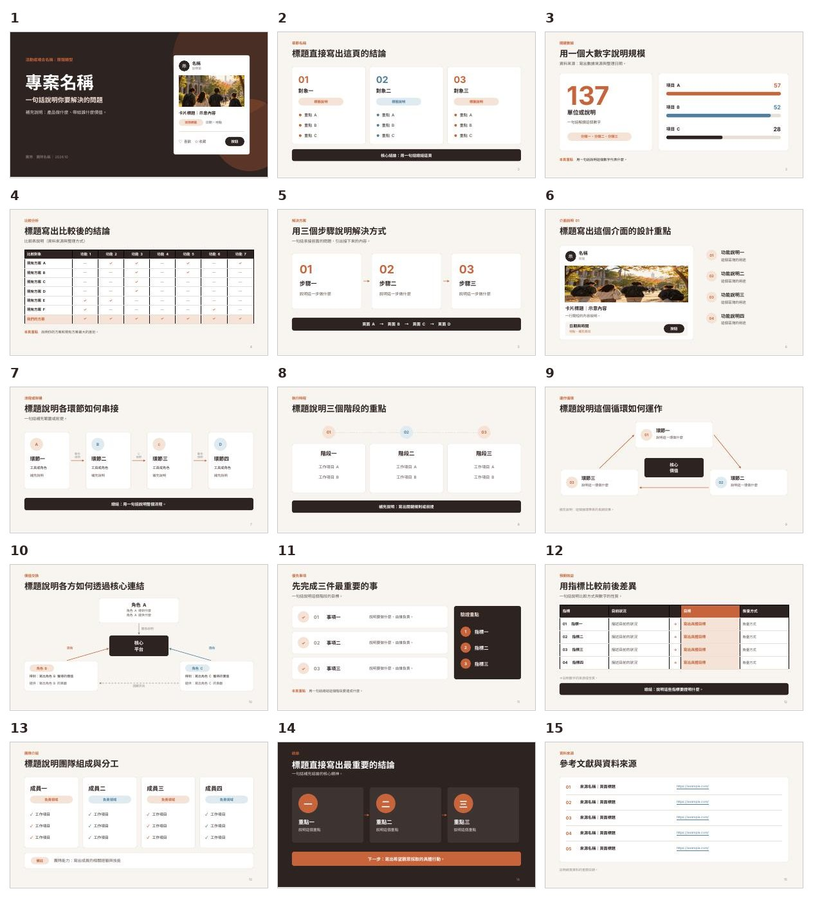

# AI Making Presentation Skills

用 AI 做簡報的工具包：省 token 的 Claude Code 指令、可直接套用的簡報模板，以及整理好的簡報設計原則。



## 內容

```
├── prompts/                         給 Claude Code 的設定與簡報指令
│   ├── CLAUDE.md                    使用者層級的全域設定（含辦公檔案省 token 規則）
│   ├── canva-edit.md                修改現有的 Canva 簡報
│   └── pptx-create-edit.md          建立或修改 pptx 檔
├── template/                        簡報模板
│   ├── presentation-template.pptx   暖色系模板，15 種版型
│   ├── preview.jpg                  暖色系模板預覽圖
│   ├── sticky-note-template.pptx    便利貼提案模板，18 種版型
│   ├── sticky-note-preview.jpg      便利貼模板預覽圖
│   └── build_sticky_note_template.py  產生便利貼模板的腳本
└── guides/                          簡報設計參考
    ├── design-research.md           什麼是好的簡報（附資料來源）
    └── good-presentation-checklist.md  好簡報的 49 個檢查點
```

| 資料夾 | 說明 | 適合誰 |
|---|---|---|
| [`prompts/`](prompts/) | 一份全域 `CLAUDE.md`，加上兩份讓 Claude Code 自動做簡報的指令，以最少 token 為目標，並內建一次視覺檢查。 | 想用 AI 自動產出或修改簡報的人 |
| [`template/`](template/) | 從實際提案簡報整理出的兩份模板，都是 16:9：暖色系模板有 15 種版型；便利貼提案模板有 18 種版型，包含漏斗圖、關係人表、指標、效益試算表與長條圖。 | 想快速做出一份好看簡報的人 |
| [`guides/`](guides/) | 整理學術期刊與設計資源的建議，以及 49 個可逐項檢查的重點。 | 想知道怎樣才算好簡報的人 |

## 快速開始

**用模板手動製作**

1. 下載 [`template/presentation-template.pptx`](template/presentation-template.pptx)（暖色系）或 [`template/sticky-note-template.pptx`](template/sticky-note-template.pptx)（便利貼風格）。
2. 依內容挑選版型，把提示文字換成自己的內容。
3. 完成後對照 [49 個檢查點](guides/good-presentation-checklist.md) 檢查一遍。

**讓 AI 自動製作或修改**

1. （選用）把 [`prompts/CLAUDE.md`](prompts/CLAUDE.md) 放到 `~/.claude/CLAUDE.md`，當作全域設定。
2. 依情況選擇 [Canva 版或 pptx 版指令](prompts/)。
3. 開一個新的 Claude Code 對話，貼上指令，只填寫最下面的 `<request>` 區塊。
4. pptx 版可以在 `<request>` 的 `FILE` 填入模板路徑，讓 AI 在模板上修改。

## 三個最重要的原則

如果只記得三件事：

1. **每頁只講一個重點**，觀眾要能在 3 秒內看懂。
2. **標題直接寫結論**，例如「循環杯減量效果最好」，而不是「方案比較」。
3. **少即是多**：2～3 種顏色、最多 2 種字型、條列最多 5 點，並保留足夠留白。

完整說明請見 [`guides/`](guides/)。
