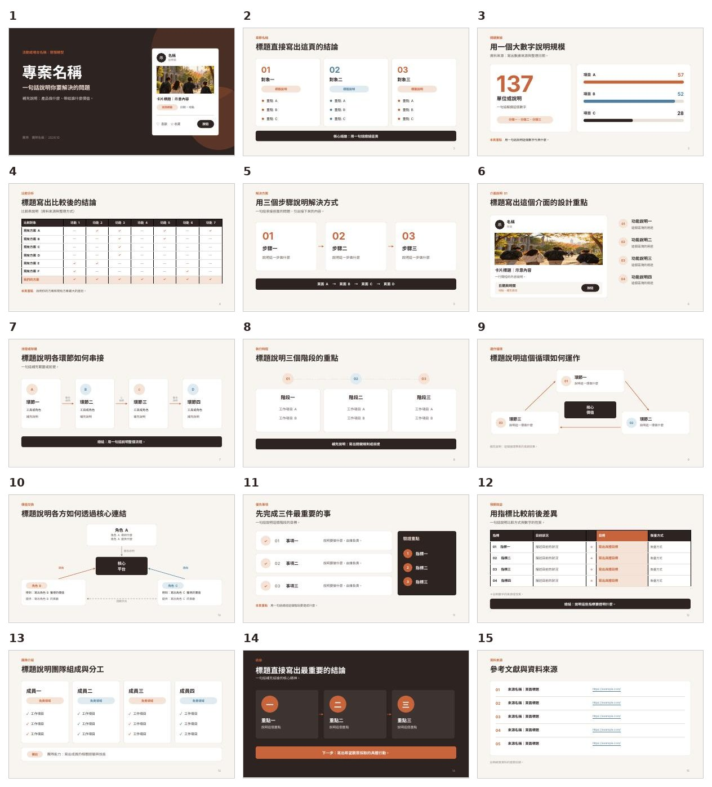

# 簡報模板

[`presentation-template.pptx`](presentation-template.pptx) 是從一份 31 頁的黑客松提案簡報整理出來的模板。保留原本的配色、字型和版面，挑出 15 種不重複的版型，所有文字都換成填寫提示（例如「標題直接寫出這頁的結論」）。

## 15 種版型

| 頁 | 版型 | 適合放什麼 |
|---|---|---|
| 1 | 深色封面＋手機卡片示意 | 專案名稱、一句話說明要解決的問題 |
| 2 | 三欄編號卡片 | 三個對象、三個問題或三個面向 |
| 3 | 大數字＋長條比例 | 一個關鍵數據與它的組成 |
| 4 | 多欄比較表 | 和現有方案逐項比較 |
| 5 | 三步驟流程 | 解決方案的步驟 |
| 6 | 手機介面＋四點說明 | 介面或產品功能說明 |
| 7 | 四格橫向流程 | 系統架構、作業流程 |
| 8 | 三階段時間軸 | 執行時程 |
| 9 | 三點循環圖 | 運作機制、回饋循環 |
| 10 | 中心輻射圖 | 各方之間的價值交換 |
| 11 | 清單＋深色側欄 | 優先事項與驗證指標 |
| 12 | 前後比較表 | 預期效益、衡量指標 |
| 13 | 四人卡片 | 團隊分工 |
| 14 | 深色結論頁 | 三個重點＋下一步行動 |
| 15 | 編號清單 | 參考資料與來源 |

## 設計規格

**比例**：16:9

**字型**：整份只用 Noto Sans TC，並已嵌入檔案，換電腦開啟也不會跑掉。

**配色**：暖色系，一個主色搭配一個強調色，對比清楚。

| 用途 | 色碼 |
|---|---|
| 深色（文字、深色頁、底部總結橫條） | `#2D2321` 深咖啡 |
| 背景 | `#F8F5F0` 暖白 |
| 主強調色 | `#C8643B` 赭橘 |
| 次強調色 | `#4F7FA0` 灰藍 |
| 淺色標籤底 | `#F6E3D7` 淺橘、`#DFEAF1` 淺藍 |
| 次要文字 | `#978A82` 灰褐 |

**每頁的固定結構**

1. 左上角小標籤：章節名稱
2. 大標題：直接寫出這頁的結論
3. 一行副標：補充說明
4. 主要內容：卡片、圖表或流程圖
5. 底部深色橫條或「本頁重點」：一句話總結

封面和結論頁用深色背景，中間內容頁用淺色背景，前後呼應。

## 使用方式

1. 用 PowerPoint 或 Keynote 開啟，也可以上傳到 Google 簡報或 Canva。
2. 依內容挑選需要的版型，同一種版型要用很多次時，直接複製那一頁。
3. 把提示文字換成自己的內容，用不到的頁面刪掉。

## 注意事項

- **照片**：第 1 和第 6 頁的照片是原簡報使用的校園照片，請點選圖片後右鍵「變更圖片」換成自己的。
- **長條比例**：第 3 頁的長條長度是固定的圖形，修改數字後要手動調整長條長度。
- **字級**：原簡報的內文多在 9～13pt，適合線上閱讀或近距離觀看。如果要在大教室投影，建議把內文放大到 18pt 以上。
- **檔案大小**：約 10MB，主要來自嵌入的字型（約 6.4MB）和照片。
