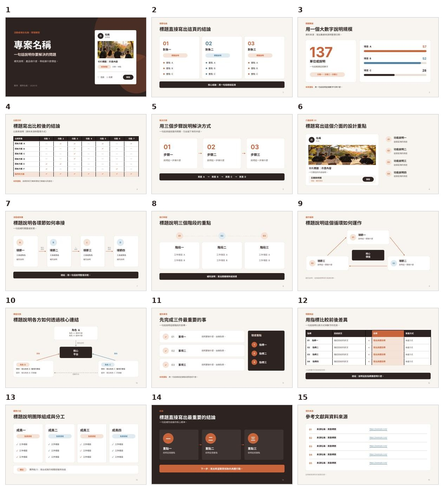
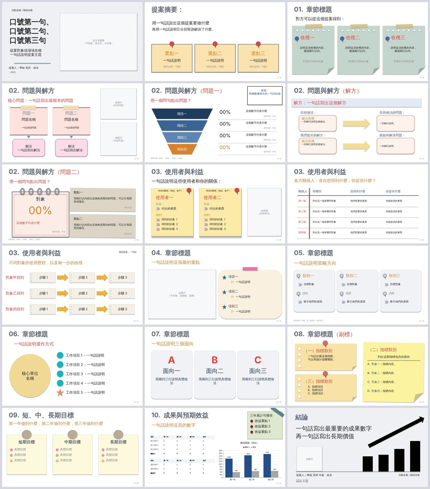

# 簡報模板

這個資料夾有兩份模板，都是 16:9、文字已換成填寫提示：

| 模板 | 風格 | 版型數 | 適合 |
|---|---|---|---|
| [`presentation-template.pptx`](presentation-template.pptx) | 暖色系、深淺頁交替 | 15 | 產品或服務提案，需要介面示意、團隊介紹 |
| [`sticky-note-template.pptx`](sticky-note-template.pptx) | 便利貼、圖釘、膠帶的手作感 | 18 | 場域規劃、招商、產學合作等商業提案，需要數據、表格、效益試算 |

---

## 一、暖色系模板

[`presentation-template.pptx`](presentation-template.pptx) 是從一份 31 頁的黑客松提案簡報整理出來的模板。保留原本的配色、字型和版面，挑出 15 種不重複的版型，所有文字都換成填寫提示（例如「標題直接寫出這頁的結論」）。



### 15 種版型

| 頁 | 版型 | 適合放什麼 |
|---|---|---|
| 1 | 深色封面＋手機卡片示意 | 專案名稱、一句話說明要解決的問題 |
| 2 | 三欄編號卡片 | 三個對象、三個問題或三個面向 |
| 3 | 大數字＋長條比例 | 一個關鍵數據與它的組成 |
| 4 | 多欄比較表 | 和現有方案逐項比較 |
| 5 | 三步驟流程 | 解決方案的步驟 |
| 6 | 手機介面＋四點說明 | 介面或產品功能說明 |
| 7 | 四格橫向流程 | 系統架構、作業流程 |
| 8 | 三階段時間軸 | 執行時程 |
| 9 | 三點循環圖 | 運作機制、回饋循環 |
| 10 | 中心輻射圖 | 各方之間的價值交換 |
| 11 | 清單＋深色側欄 | 優先事項與驗證指標 |
| 12 | 前後比較表 | 預期效益、衡量指標 |
| 13 | 四人卡片 | 團隊分工 |
| 14 | 深色結論頁 | 三個重點＋下一步行動 |
| 15 | 編號清單 | 參考資料與來源 |

### 設計規格

**比例**：16:9

**字型**：整份只用 Noto Sans TC，並已嵌入檔案，換電腦開啟也不會跑掉。

**配色**：暖色系，一個主色搭配一個強調色，對比清楚。

| 用途 | 色碼 |
|---|---|
| 深色（文字、深色頁、底部總結橫條） | `#2D2321` 深咖啡 |
| 背景 | `#F8F5F0` 暖白 |
| 主強調色 | `#C8643B` 赭橘 |
| 次強調色 | `#4F7FA0` 灰藍 |
| 淺色標籤底 | `#F6E3D7` 淺橘、`#DFEAF1` 淺藍 |
| 次要文字 | `#978A82` 灰褐 |

**每頁的固定結構**

1. 左上角小標籤：章節名稱
2. 大標題：直接寫出這頁的結論
3. 一行副標：補充說明
4. 主要內容：卡片、圖表或流程圖
5. 底部深色橫條或「本頁重點」：一句話總結

封面和結論頁用深色背景，中間內容頁用淺色背景，前後呼應。

### 使用方式

1. 用 PowerPoint 或 Keynote 開啟，也可以上傳到 Google 簡報或 Canva。
2. 依內容挑選需要的版型，同一種版型要用很多次時，直接複製那一頁。
3. 把提示文字換成自己的內容，用不到的頁面刪掉。

### 注意事項

- **照片**：第 1 和第 6 頁的照片是原簡報使用的校園照片，請點選圖片後右鍵「變更圖片」換成自己的。
- **長條比例**：第 3 頁的長條長度是固定的圖形，修改數字後要手動調整長條長度。
- **字級**：原簡報的內文多在 9～13pt，適合線上閱讀或近距離觀看。如果要在大教室投影，建議把內文放大到 18pt 以上。
- **檔案大小**：約 10MB，主要來自嵌入的字型（約 6.4MB）和照片。

---

## 二、便利貼提案模板

[`sticky-note-template.pptx`](sticky-note-template.pptx) 是從一份 19 頁的黑客松初審提案簡報（場域招商規劃）整理出來的模板。保留原本的配色、便利貼與圖釘的版面，挑出 18 種不重複的版型，所有文字都換成填寫提示，圖片位置改成虛線框。



### 18 種版型

| 頁 | 版型 | 適合放什麼 |
|---|---|---|
| 1 | 封面：三句口號＋主視覺圖 | 活動名稱、口號式主標題、提案人 |
| 2 | 提案摘要＋三張圖釘便利貼 | 一句話提案，加上三個主要章節 |
| 3 | 三欄膠帶卡（摺角） | 對方可以得到的三個好處 |
| 4 | 問題 → 解法總覽 | 兩個問題各自對應的解法 |
| 5 | 漏斗圖＋數據列 | 一路流失的比例，每列附資料來源 |
| 6 | 現況與解方 2×2 對照 | 目前做法、它的問題、你的解方、如何解決 |
| 7 | 大數字筆記本＋兩張紙條 | 一個關鍵數字，加上兩個角度的佐證 |
| 8 | 付出／得到便利貼＋插圖 | 每種使用者付出什麼、得到什麼 |
| 9 | 關係人表 | 四類關係人的需求與你的提供 |
| 10 | 三列歷程流程 | 三種對象各自的三個步驟 |
| 11 | 圖片＋說明清單 | 平面圖、架構圖，右邊解釋三個重點區塊 |
| 12 | 三欄灰卡 | 三種目標類別與誘因 |
| 13 | 中心圓＋工作清單 | 核心單位負責的 4～5 件事 |
| 14 | 三面向大字母 | ESG、三大支柱 |
| 15 | 指標便利貼 | 主要指標、分項指標、門檻指標 |
| 16 | 短中長期目標 | 三個階段各 2～3 個目標 |
| 17 | 表格＋長條圖＋結論便利貼 | 收入、成本與效益試算 |
| 18 | 結論頁 | 兩句話收尾，附計算方法與參考資料連結 |

### 設計規格

**字型**：Noto Sans TC（沒有嵌入檔案，電腦沒有安裝時會用其他中文字型代替，可到 Google Fonts 免費下載）。

**配色**：白底，淺灰封面與結論頁；標題灰、副標橘、問題與重點用紅色。

| 用途 | 色碼 |
|---|---|
| 大標題 | `#5E6573` 灰藍 |
| 副標、強調數字 | `#D9822B` 橘 |
| 問題、重點 | `#E8423F` 紅 |
| 封面與結論背景 | `#EEF0F4` 淺灰 |
| 便利貼 | `#FBE3B0` 黃、`#C3D5CD` 灰綠、`#FDE2DE` 淺粉、`#FDF9DC` 米白 |
| 卡片 | `#F1F2F6` 淺灰 |
| 漏斗與圖表 | `#1F3B5E`、`#3B6495`、`#5D86B5` 藍，最後一階用橘色 |

**每頁的固定結構**

1. 大標題：`01. 章節名稱`，需要時在後面加紅色小標，例如「（問題一）」
2. 一行副標：橘色或紅色，直接寫出這頁的結論或問句
3. 主要內容：便利貼、卡片、表格或圖表
4. 有引用數據的頁面，左下角列出資料來源
5. 右下角頁碼

### 使用方式

1. 用 PowerPoint 開啟，也可以上傳到 Google 簡報或 Canva。
2. 依內容挑選版型，用不到的頁面刪掉；同一種版型要用很多次時，直接複製那一頁（例如第 6 頁可以複製成「解方一」「解方二」）。
3. 把提示文字換成自己的內容，虛線框換成圖片或圖示。每頁的備忘稿有這個版型的用途說明。
4. 第 17 頁的長條圖是 PowerPoint 原生圖表，按右鍵「編輯資料」就能改數字。

### 重新產生

模板是用 [`build_sticky_note_template.py`](build_sticky_note_template.py) 產生的，想改配色或字型，可以改檔案開頭的 `C` 與 `FONT` 再重新產生：

```
uv run --with python-pptx python build_sticky_note_template.py sticky-note-template.pptx
```

